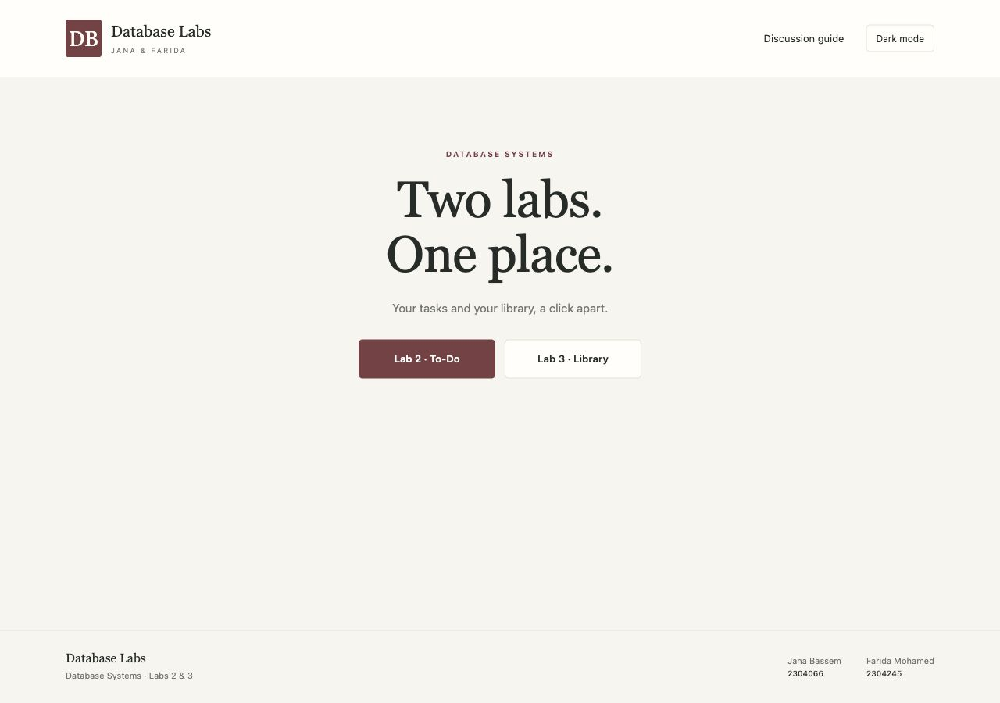
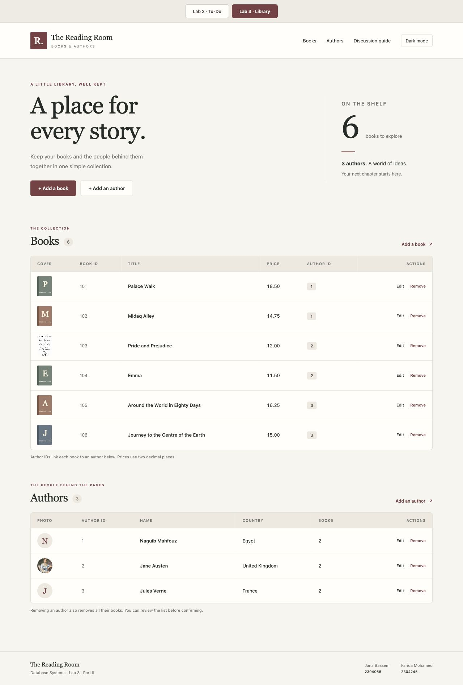

# The Reading Room - Database Lab 3, Part II

**Jana Bassem - 2304066**  
**Farida Mohamed - 2304245**

A simple local website for a library's authors and books, built with Python, Flask, MySQL, HTML, CSS and a little JavaScript.

## Scope

This folder combines your original **Lab 2 login and to-do website** with **Lab 3 Part II / Problem 2**, including F2.1-F2.5 and both image bonuses. Open **http://127.0.0.1:5003/** and choose one of the two buttons. The same two buttons appear inside both labs, so you can switch in either direction.

Your own Lab 2 application, credited to Jana Bassem Said 2304066, is included under `website/lab2/`. Its original folder is unchanged. Existing accounts and tasks remain in `registration`; the library uses `library_lab3_2304066`. Switching to the library and back keeps your Lab 2 login. Part I of Lab 3 is not included.

The local website is at **http://127.0.0.1:5003/library/** while the server is running. The discussion guide is at **http://127.0.0.1:5003/library/discussion**.





## What is included

| Requirement | Where to show it |
| --- | --- |
| F2.1: books table with author_id, plus authors table | Library home page |
| F2.2: add a book and add an author | Add a book / Add an author |
| F2.3: edit both kinds of record | Edit beside each row |
| F2.4: remove a book | Remove beside a book |
| F2.5: remove an author and their books | Remove beside an author, review, confirm |
| Bonus: upload a book cover | Image field on Add/Edit book |
| Bonus: upload an author photo | Image field on Add/Edit author |
| Seed data | 3 authors and 6 books in problem2_DML.sql |

Both bonuses support upload, preview, replacement and removal. Images are optional. Without an upload, the page shows an initial, not a downloaded picture. PNG, JPG and WebP files are accepted, with a 5 MB request limit and a 20-megapixel image limit.

The prepared local website already demonstrates both bonuses: an uploaded image for book 103 and a portrait for author 2. The ZIP includes the originals in `demo-images/`, with credits in `demo-images/SOURCES.md`, so you can repeat both uploads after a clean setup. Uploaded files themselves are excluded from the ZIP.

## Files

```text
lab3-2304066/
  problem2_DDL.sql          create exactly AUTHOR and BOOK
  problem2_DML.sql          insert the original 3 authors and 6 books
  problem2_discussion.sql   small demonstration queries
  README.md                setup and demonstration instructions
  DISCUSSION.md            explanations and lecture references
  manage.py                local setup, run, check and reset helper
  website/
    lab2/                  your existing login and to-do app
    app.py                 Flask application and configuration
    library.py             pages, queries, validation and image handling
    requirements.txt
    .env.example           safe configuration template
    templates/             HTML pages
    static/
      style.css
      app.js
      uploads/             uploaded images, ignored by Git
  tests/test_library.py    isolated tests against real MySQL
  .vscode/                 Python interpreter and Run/Debug configuration
```

Your local `website/.env` contains the connection settings. It is excluded from Git and the ZIP. Never commit it. The source files do not contain your database password.

## Run on your Mac

### 1. Open the folder

In VS Code, choose **File > Open Folder**, and select `lab3-2304066`. Use the integrated terminal in this folder.

### 2. Create the Python environment

This is already prepared in the local project. On another computer or after extracting the ZIP:

```sh
python3 -m venv .venv
source .venv/bin/activate
python -m pip install -r website/requirements.txt
```

On Windows, activate with `.venv\Scripts\activate` instead.

### 3. Configure the database connection

Make sure your MySQL server is running. Copy the example once:

```sh
cp website/.env.example website/.env
```

Edit `website/.env` in VS Code. Set `DB_USER` and `DB_PASSWORD` to your local MySQL credentials. Keep:

```text
DB_HOST=127.0.0.1
DB_PORT=3306
DB_NAME=library_lab3_2304066
LAB2_DB_NAME=registration
PORT=5003
```

Do not overwrite the already configured local `.env` unless you intend to change it.

### 4. Create and seed the database

The database is already prepared locally. On a new machine, use the MySQL client as required by the handout:

```sh
mysql -h 127.0.0.1 -u root -p < problem2_DDL.sql
mysql -h 127.0.0.1 -u root -p < problem2_DML.sql
```

On this Mac, if `mysql` is not on your PATH, its executable is `/opt/homebrew/opt/mysql@8.4/bin/mysql`.

The alternative helper runs those same files with the MySQL client and reads your local `.env`:

```sh
python manage.py init
```

`init` refuses to replace an existing assignment database. To intentionally restore the original data later, use `python manage.py reset` and type `RESET`. Reset replaces the assignment database and removes uploaded images. It does not modify the other databases.

**Run DDL before DML.** DDL resets the assignment database. DML alone is not intended to run twice because its primary keys already exist.

### 5. Start the website

```sh
source .venv/bin/activate
python website/app.py
```

Open **http://127.0.0.1:5003/** and choose **Lab 2 · To-Do** or **Lab 3 · Library**. Keep the terminal open. Press Ctrl+C to stop the server. You can also use `python manage.py run`, or the supplied VS Code Run/Debug configuration if the Python debugger extension is installed.

If port 5003 is busy, change `PORT` in `.env` and use that new port in the browser. This is a local classroom application and binds only to your computer's loopback address.

## Use DBeaver for the discussion

1. Open your existing MySQL connection at `localhost:3306`.
2. Refresh **Databases**. Open **library_lab3_2304066 > Tables**.
3. Open **AUTHOR > Data** to see 3 authors. Open **BOOK > Data** to see 6 books.
4. Open **BOOK > Properties > Foreign Keys** to inspect its link to AUTHOR and the `CASCADE` deletion rule. The Diagram tab also displays the relationship.
5. To run a file, use **SQL Editor > Open SQL Script**, select the file and the localhost connection. Run DDL first, then DML with **Execute SQL Script**. These scripts replace the assignment data, so do this only when you intend to reset it.
6. Open `problem2_discussion.sql`. Run the first two SELECT statements to display both tables. Run later examples one statement at a time while explaining them.
7. After website changes, use **Refresh** in the table's Data tab. Both tools work on the same MySQL database.

## A five-minute demonstration

1. Show the two tables in the website and in DBeaver. Explain the PK and FK.
2. Add author **9001**, name **Discussion Author**, country **Egypt**, with an image from your computer.
3. Add book **9001**, title **Discussion Book**, price **20.00**, author **9001**, with a cover image. Refresh to show both images persist.
4. Edit the book's title/price and the author's name/country. Show the changes in DBeaver.
5. Remove that book. The author remains. Add another book for author 9001.
6. Open Remove for author 9001. Review the affected book list, then confirm. MySQL automatically deletes the related books through `ON DELETE CASCADE`.
7. Show the FK error example in `problem2_discussion.sql`: inserting a book for nonexistent author 999999 fails. That intentionally failing statement is commented out and is not part of setup.

Use temporary demonstration IDs so the original seed data stays intact. The original seed records are authors 1-3 and books 101-106.

## SQL stays within the course material

The schema uses `CREATE DATABASE`, `USE`, `CREATE TABLE`, `INT`, `VARCHAR`, `DECIMAL(10,2)`, `NOT NULL`, `PRIMARY KEY`, `FOREIGN KEY` and `ON DELETE CASCADE`. The reset script includes the `DROP DATABASE IF EXISTS` setup pattern explicitly shown in LAB3.pdf.

The website uses only simple `SELECT`, `INSERT`, `UPDATE` and `DELETE` statements, with `WHERE` when it targets a row. There are **no JOINs, GROUP BY, HAVING, subqueries, views, triggers or stored procedures** in the app. Counts and display ordering use Python. Image uploads use Python and files, without extra database tables or columns. Infrastructure checks such as `SHOW DATABASES` in the helper/tests are setup checks, not assignment query features.

## Image storage

Uploads are stored as `website/static/uploads/book-<id>.png` or `author-<id>.png`. The server verifies the actual file contents and normalizes accepted images to PNG. Images are kept outside SQL because the given schema contains no image column and the lab asks for only two tables.

Replacing an image uses the same record-specific filename. The website removes the matching file when a record is deleted. MySQL cascades database rows; Python removes image files. Direct deletion in DBeaver does not run Python file cleanup. The reset helper clears the uploaded images together with the rows to avoid stale pictures after reusing IDs.

## Verify the installation

```sh
python manage.py check
python -m unittest discover -s tests -v
```

The integration tests create their own database with a unique process ID and remove only that test database afterward. They check the schema and seed data, add/edit/delete flows, referential integrity, cascade behavior, image uploads/replacement/removal, invalid inputs and form protection. They do not change the prepared assignment database or its images. The MySQL account needs permission to create and drop that disposable test database.

## How the two labs are linked

One Python process serves both apps at port 5003. The home page has two buttons:

- **Lab 2 · To-Do** opens `/lab2/` (login first, or your tasks if already signed in).
- **Lab 3 · Library** opens `/library/`.

The two buttons also appear at the top of both labs. Lab 2's existing routes and static files are mounted under `/lab2` using Werkzeug's `DispatcherMiddleware`. Lab 2 keeps its original templates, task ownership checks, password hashing and server-side sessions. Its redirects and form actions retain the `/lab2` prefix. The apps use different session cookies, so switching labs does not overwrite a login or form token.

**Existing local data:** the prepared app connects Lab 2 to the existing `registration` database. No Lab 2 schema or data has been reset.

**New machine only:** if `registration` does not exist yet, create it once with the included original schema:

```sh
mysql -h 127.0.0.1 -u root -p < website/lab2/database/schema.sql
```

That original script resets `registration`, so do not run it over accounts and tasks you want to keep. Library setup remains `problem2_DDL.sql` followed by `problem2_DML.sql`. `manage.py init/reset` manages only the library, not Lab 2.

The shared `.env` uses `LAB2_DB_NAME=registration` for Lab 2 and `DB_NAME=library_lab3_2304066` for Lab 3. Both use the same local server credentials. Runtime Lab 2 session files under `website/lab2/instance/` are private and excluded from Git and the ZIP.

Run the original Lab 2 regression tests separately:

```sh
cd website/lab2
../../.venv/bin/python -m unittest discover -s tests -q
```

Those original tests use the original in-memory adapter. The combined tests in the root `tests/` folder additionally verify real MySQL registration, task creation, switching labs, login persistence and logout against disposable test databases.

## Submission preparation

Upload the source files and `.env.example` to your repository. Exclude `.venv`, `__pycache__`, your private `.env`, Lab 2 session files and personal uploaded photos. The supplied ZIP omits those local files. Keep the required DDL/DML filenames. The public repository is https://github.com/janabassem99/lab3-2304066. Farida can open it, click **Fork**, and create a copy in her own GitHub account. Each person must create their own local `.env` from `.env.example` and follow the setup steps above. Publishing here does not submit the lab form.
